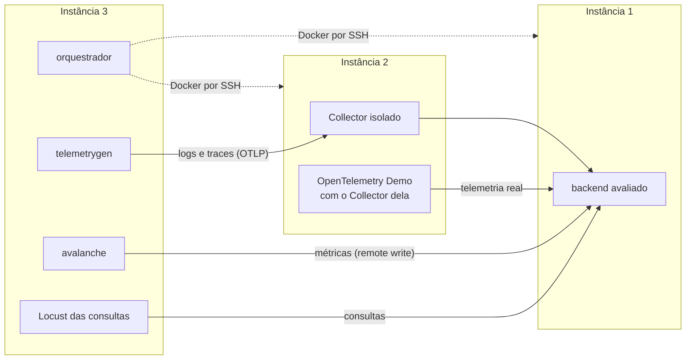

# Comparação de backends de observabilidade

Código experimental do Trabalho de Conclusão de Curso **"Observabilidade em microsserviços: uma análise comparativa de backends para logs, métricas e traces"**.

- **Autor:** Francisco Lucas Soares Batista
- **Orientador:** Bruno Riccelli dos Santos Silva
- **Curso:** Ciência da Computação, Universidade Federal do Ceará, campus Crateús

O trabalho compara duas ferramentas de armazenamento e consulta (backends) para cada pilar da observabilidade, sob as mesmas condições de carga e de hardware:

| Pilar | Ferramenta A | Ferramenta B | Armazenamento |
|---|---|---|---|
| Logs | Loki | Elasticsearch | próprio de cada um |
| Métricas | Prometheus | VictoriaMetrics | próprio de cada um |
| Traces | Jaeger | Zipkin | Elasticsearch nos dois |

Os critérios comparados são o consumo de CPU e de memória, a vazão máxima, o uso de disco, a perda de dados, o efeito do número de séries nas métricas e o tempo das consultas em logs e traces.

## Arquitetura

O experimento roda em três instâncias EC2 na mesma região da AWS. O orquestrador, na instância 3, comanda o Docker das outras duas por SSH.

| Instância | Tipo | Papel |
|---|---|---|
| 1 | m7a.xlarge | backend avaliado e o Elasticsearch, quando usado |
| 2 | m7a.2xlarge | OpenTelemetry Collector ou OpenTelemetry Demo |
| 3 | m7a.xlarge | orquestrador e geradores de carga |



A carga chega ao backend por três caminhos:

- **Logs e traces sintéticos:** o telemetrygen envia por OTLP ao Collector isolado, que converte e envia ao backend.
- **Métricas sintéticas:** o avalanche envia direto ao backend por escrita remota (remote write), para que o Collector não limite a taxa.
- **Cenário realista:** a OpenTelemetry Demo 3.1.0, uma loja virtual de microsserviços, gera telemetria real sob a carga do Locust dela. O Collector da Demo envia ao backend só o sinal do par avaliado.

Em todas as instâncias, o cAdvisor lê a CPU e a memória de cada contêiner a cada segundo.

## Experimentos

| Experimento | O que mede | Condições | Execuções |
|---|---|---|---|
| Saturação | vazão máxima de cada ferramenta | degraus de 3 min, de 50% a 150% da vazão estimada, em passos de 10% | 6 ferramentas × 5 = 30 |
| Ingestão | CPU, memória e perda sob carga constante | 25%, 50% e 75% de S, por 12 min | 6 × 3 × 5 = 90 |
| Cardinalidade | efeito do número de séries nas métricas | 100 mil, 500 mil e 1 milhão de séries, por 12 min | 2 × 3 × 5 = 30 |
| Cenário realista | CPU, memória, perda e disco com dados reais | Demo com 50 usuários, por 12 min | 6 × 5 = 30 |
| Consulta | tempo das consultas | volume fixo e 30 consultas medidas | 4 × 5 = 20 |

S é a vazão de referência de cada par, a menor vazão máxima entre as duas ferramentas. Assim as duas recebem a mesma carga, e nenhuma é levada além do que aguenta. Nos experimentos de 12 minutos, os 2 primeiros são descartados como aquecimento.

As 200 execuções são feitas em 5 blocos aleatorizados. Cada bloco contém uma repetição de cada uma das 40 combinações de experimento, ferramenta e condição, em ordem sorteada. Isso espalha as ferramentas ao longo do tempo, para que variações de desempenho da nuvem não favoreçam sempre a mesma.

Cada execução segue o mesmo roteiro, definido em `orquestrador/execucao.py`:

1. **limpeza:** remove o Collector e todos os backends, com os dados, e esvazia o cache de disco das instâncias
2. **inicialização:** sobe o cAdvisor, o backend avaliado e, quando há, o Collector
3. **carga:** aplica a carga do experimento enquanto mede CPU e memória
4. **registro:** lê no Collector quantos itens foram enviados
5. **descarga:** força o backend a gravar os dados, conta o que ficou armazenado e, no cenário realista, mede o disco
6. **exportação:** resume as medidas e grava o `resumo.json`, que marca a execução como concluída

## Estrutura do repositório

```
├── orquestrador/            scripts dos experimentos, executados na instância 3
│   ├── rodar.py             experimento completo, em blocos aleatorizados e com retomada
│   ├── saturacao.py         saturação em degraus (e rampa, usada no piloto)
│   ├── ingestao.py          ingestão a 25%, 50% e 75% de S
│   ├── cardinalidade.py     cardinalidade no par de métricas
│   ├── realista.py          cenário realista com a OpenTelemetry Demo
│   ├── consultas.py         experimento de consulta
│   ├── execucao.py          roteiro comum a todas as execuções
│   ├── carga.py             geradores de carga e leitura de contadores
│   ├── medicao.py           CPU e memória lidas do cAdvisor
│   ├── collector.py         Collector isolado
│   ├── geradores.py         imagens dos geradores
│   ├── formato.py           formato dos logs e traces sintéticos
│   ├── config.py            caminhos, versões e endereços das instâncias
│   ├── verificar.py         verificação do ambiente
│   └── backends/            uma classe por backend
├── backends/                compose e configuração de cada backend
├── collector/               configuração do Collector isolado, uma por par
├── consultas/               consultas do Locust e aquecimento das consultas
├── demo/                    ajustes da OpenTelemetry Demo e do Collector dela
├── monitoramento/cadvisor/  compose do cAdvisor
├── scripts/
│   ├── gerar_logs_consulta.py   arquivos de logs do experimento de consulta
│   └── piloto/              análises usadas para calibrar os parâmetros
├── versoes.env              versões fixadas de todas as ferramentas
├── ambiente.env.exemplo     exemplo da configuração das instâncias
├── requirements.txt         dependências do orquestrador
└── requirements-analise.txt dependências da análise dos resultados
```

## Versões

Todas as versões estão fixadas em `versoes.env`.

| Ferramenta | Versão |
|---|---|
| Elasticsearch | 9.5.5 |
| Loki | 3.7.8 |
| Prometheus | v3.13.3 |
| VictoriaMetrics | v1.154.0 |
| Jaeger | 2.21.0 |
| Zipkin | 3.6.1 |
| OpenTelemetry Collector (contrib) | 0.159.0 |
| telemetrygen | v0.159.0 |
| avalanche | v0.7.0 |
| OpenTelemetry Demo | 3.1.0 |
| Locust (consultas) | 2.46.7 |
| cAdvisor | v0.55.1 |

## Como reproduzir

### Pré-requisitos

- Três instâncias com Ubuntu, nos tipos da tabela de arquitetura, na mesma VPC, com os volumes de disco gp3. A instância 1 precisa de um volume de dados de pelo menos 50 GiB.
- Docker com o plugin compose nas três.
- Acesso por SSH, com chave e o usuário `ubuntu`, da instância 3 para as instâncias 1 e 2.
- O repositório clonado em `~/comparacao-backends-observabilidade` **nas três instâncias**, sempre na mesma versão. Os arquivos de configuração montados nos contêineres são lidos do disco da instância onde o contêiner roda.

### Preparação

Nas três instâncias:

```
git clone <endereço do repositório> ~/comparacao-backends-observabilidade
docker network create tcc
```

Na instância 3:

```
cd ~/comparacao-backends-observabilidade
python3 -m venv .venv && source .venv/bin/activate
pip install -r requirements.txt
cp ambiente.env.exemplo ambiente.env    # e troque os IPs pelos IPs privados das instâncias
```

O `ambiente.env` também define os limites de memória dos backends e do Collector. Sem ele, tudo roda na máquina local, com limites menores, o que serve para testar o código num computador pessoal.

### Verificação do ambiente

Antes do experimento, confira que cada backend recebe e guarda os dados corretamente. A partir da pasta `orquestrador`, na instância 3:

```
python verificar.py --lista          # casos disponíveis
python verificar.py logs-loki        # um caso: carga pequena, contagem e disco
python verificar.py parar            # remove tudo ao terminar
```

### Execução

O experimento completo roda com o `rodar.py`. Como leva dias, convém rodá-lo dentro do `tmux`:

```
tmux new -s experimento
cd ~/comparacao-backends-observabilidade && source .venv/bin/activate && cd orquestrador
python rodar.py --plano       # mostra o plano, o andamento e o tempo estimado
python rodar.py               # roda as execuções pendentes
```

Opções do `rodar.py`:

| Opção | Efeito |
|---|---|
| `--plano` | mostra o plano e o andamento, sem executar |
| `--horas N` | não inicia execuções novas depois de N horas, para dividir o experimento em dias |
| `--experimentos X Y` | roda só os experimentos indicados |
| `--blocos 1 2` | roda só os blocos indicados |
| `--desligar` | desliga as três instâncias ao terminar |

A ordem sorteada fica em `resultados/plano.json`. Para continuar depois de qualquer interrupção, basta rodar o mesmo comando: as execuções concluídas são puladas. Uma execução com falha é refeita até 3 vezes, e as tentativas descartadas ficam em `resultados/_falhas`.

Cada experimento também pode ser rodado isoladamente, por exemplo:

```
python ingestao.py loki --nivel 75 --repeticao 1
python saturacao.py degraus prometheus --estimativa 638000
python realista.py execucao jaeger --usuarios 50
python consultas.py zipkin
```

Os resultados ficam só na instância 3. Copie-os ao fim de cada dia de execução, a partir do computador de análise:

```
rsync -az ubuntu@<IP público da instância 3>:~/comparacao-backends-observabilidade/resultados/ ./resultados/
```

### Arquivos de resultados

Cada execução grava uma pasta em `resultados/<experimento>/<par>/<ferramenta>/<condição>/rep<n>/`.

| Arquivo | Conteúdo |
|---|---|
| `resumo.json` | resumo da execução, gravado por último |
| `recursos_backend.csv` | CPU e memória dos contêineres da instância 1, a cada segundo |
| `recursos_collector.csv` ou `recursos_demo.csv` | o mesmo na instância 2 |
| `recursos_gerador.csv` | o mesmo na instância 3, nas métricas |
| `amostras.csv` | contadores do Collector ou do backend, a cada 5 segundos |
| `degraus.csv` e `saturacao.json` | taxas e estado de cada degrau, e a vazão máxima (saturação) |
| `tempos.csv` e `aquecimento.csv` | tempo de cada consulta medida e das consultas de aquecimento |
| `conteineres/` | logs dos contêineres da instância 1 |
| `*.log` | saída dos geradores e do Locust |

Principais campos do `resumo.json`:

| Campo | Significado |
|---|---|
| `enviados` e `armazenados` | itens enviados pelo Collector e guardados no backend (nas métricas, séries) |
| `perda_pct` | diferença entre enviados e armazenados, em porcentagem |
| `recursos_backend` | CPU média (em porcentagem de um núcleo) e memória mediana e máxima de cada contêiner, sem o aquecimento |
| `carga` | taxa pedida e entregue, e se a carga se sustentou até o fim |
| `saturacao` | vazão máxima, estado do degrau de parada e número de degraus |
| `disco_liquido_kib` e `bytes_por_item` | disco ocupado pelos dados e por item, no cenário realista |
| `consultas` | mediana, percentil 95 e variação de cada consulta |

Além das pastas das execuções, `resultados/_rodar/` guarda a saída de cada sessão do `rodar.py` e o `historico.jsonl`, com todas as tentativas.
